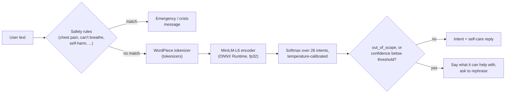
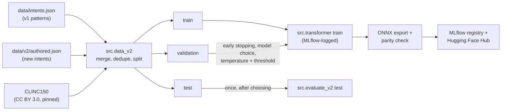
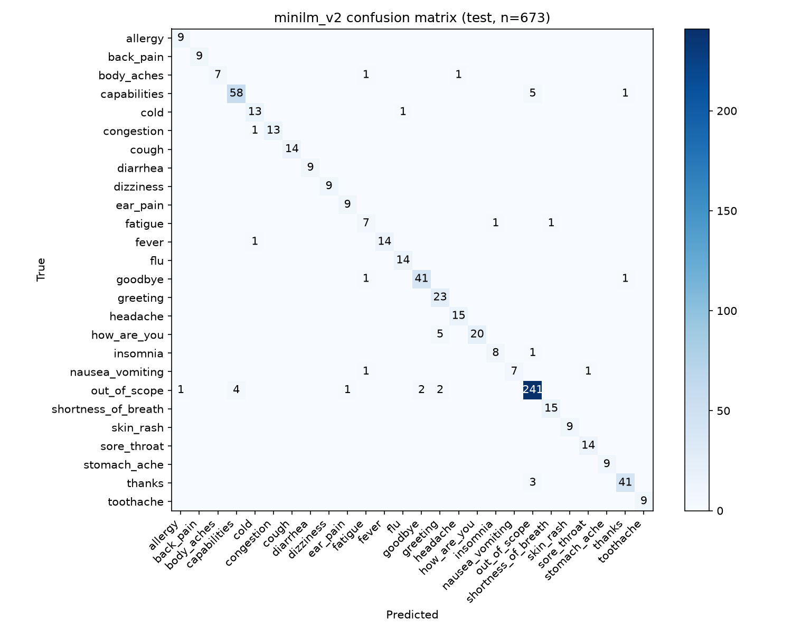
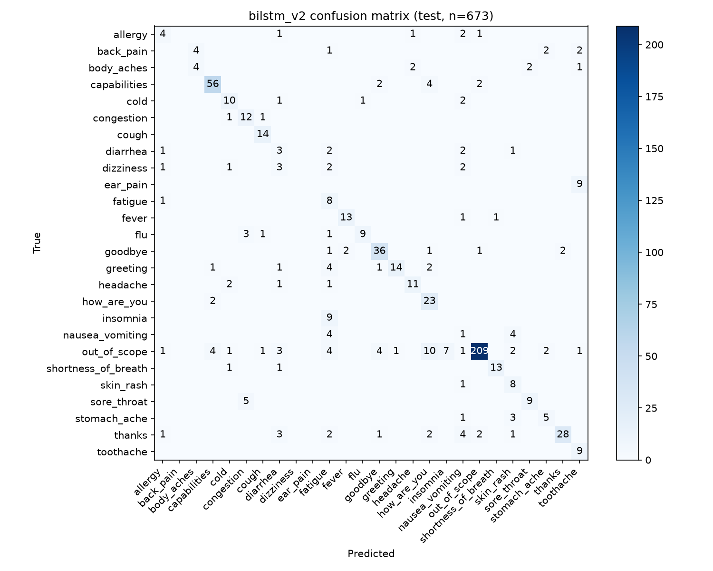

# Medical Intent Classifier

Intent classification for a healthcare chatbot. A fine-tuned **MiniLM** transformer maps a message such as "my stomach has been hurting since last night" to one of **26 intents**: 20 common symptoms, 5 conversational intents (greeting, how are you, thanks, goodbye, what can you do), and an explicit `out_of_scope` class. A rule-based safety check catches emergency phrases before the model runs.

> **Not medical advice.** This is a portfolio and learning project. It doesn't diagnose anything. For medical concerns, consult a healthcare professional; in an emergency, contact local emergency services.

**Live demo:** [medical-intent-classifier.onrender.com](https://medical-intent-classifier.onrender.com/) (chat) · [API docs](https://medical-intent-classifier.onrender.com/docs) · **Model:** [Jinamshah/medical-intent-classifier](https://huggingface.co/Jinamshah/medical-intent-classifier) on Hugging Face

> The demo runs on Render's free tier, which sleeps after 15 minutes without traffic. The first visit after that can take a couple of minutes; after that it's fast.

[](https://github.com/Jinam-Shah/Medical-Intent-Classifier/actions/workflows/ci.yml)
[](https://www.python.org/)
[](https://pytorch.org/)
[](LICENSE)

## Results

Dataset v2: 26 intents, 3,009 sentences, fixed split of 1,818 train / 518 validation / 673 test. The model was chosen on validation; the test split was evaluated once afterwards. Full details, environment, and commands: [METRICS.md](METRICS.md).

| Model | Params | Val accuracy | **Test accuracy** (95% CI) | Test macro F1 | CPU latency, 1 thread (ONNX, p50) |
|---|---|---|---|---|---|
| BiLSTM + attention (from scratch), original settings | 16.6 M | 0.757 | 0.741 (0.707 to 0.773) | 0.551 | 4.1 ms |
| BiLSTM + attention, tuned by sweep (Linux) | 3.1 M | 0.905 | 0.875 (0.848 to 0.898) | 0.828 | not measured |
| DistilBERT, fine-tuned | 67.0 M | 0.946 | 0.936 (0.915 to 0.952) | 0.931 | 10.3 ms |
| **MiniLM-L6, fine-tuned (deployed)** | 22.7 M | **0.956** | **0.947** (0.927 to 0.961) | **0.942** | **2.4 ms** |

For the deployed MiniLM model on the test split:

| | Value |
|---|---|
| Accuracy on the 388 test sentences from CLINC150, written by independent crowd workers | 0.941 |
| Accuracy on the 285 project-written test sentences (same author as the training data, so possibly optimistic) | 0.954 |
| End-to-end accuracy with the low-confidence fallback (off-topic counted correct if rejected) | 0.944 |
| Off-topic messages rejected | 96.0% |
| Latency on Render-like limits (0.1 CPU, 512 MB), over HTTP, served image | p50 100 ms, p95 201 ms; 181 MB memory |
| Live latency over HTTPS (Render free tier, warm, includes the internet round trip) | p50 131 ms, p95 150 ms |

Why MiniLM: the BiLSTM learns words from scratch, so unseen words and typos ("stomache", "tummy") become `<UNK>`. A pretrained transformer splits them into known subwords and already understands paraphrases. MiniLM matched DistilBERT's accuracy at a third of the size and a quarter of the latency ([docs/DECISIONS.md](docs/DECISIONS.md) D26).

<details>
<summary>History: the original 12-intent BiLSTM (dataset v1)</summary>

The first version of this project reported 94.6% test accuracy, but that came from an unseeded run: rerunning the identical original code gave 96.1% and 90.7%. After making training reproducible and fixing several bugs ([docs/AUDIT.md](docs/AUDIT.md)), the honest v1 result was **0.891 test accuracy** on 128 test sentences. Its calibrated fallback rejected 82.5% of off-topic messages. ONNX Runtime made it 4.4× faster than PyTorch (p50 2.0 ms). v1 numbers aren't comparable with v2: different intents, data, and test set.

</details>

## How it works



Data and training pipeline:



## Evaluation discipline

- Splits are created once with a fixed seed and committed (`data/splits/` for v1, `data/v2/splits/` for v2), so every model is scored on the same sentences. CLINC150 rows keep CLINC's own train/validation/test assignment.
- Every decision (early stopping, choosing MiniLM over DistilBERT, fp32 over int8, the temperature and the fallback threshold) used the **validation** split.
- The **test** split was evaluated once, after the choice was fixed, for all three compared models, and every result is in `METRICS.md`.
- Test results are reported separately for independently written sentences (CLINC150) and for sentences written by this project's author.

## Setup

Requires Python 3.11.

```bash
git clone https://github.com/Jinam-Shah/Medical-Intent-Classifier.git
cd Medical-Intent-Classifier
python -m venv .venv
# Windows: .venv\Scripts\activate     macOS/Linux: source .venv/bin/activate
pip install -r requirements-dev.txt --extra-index-url https://download.pytorch.org/whl/cpu
```

On Windows PowerShell, if activation fails with "running scripts is disabled on this system", allow it for the current window only with `Set-ExecutionPolicy -Scope Process Bypass`, or skip activation and call `.venv\Scripts\python -m ...` directly.

The NLTK tokenizer data (`punkt_tab`) downloads automatically on first use.

## Usage

### Dataset v2 and the transformer models (current)

```bash
# (Optional) rebuild dataset v2; the committed files are already there. Downloads pinned CLINC150.
python -m src.data_v2

# Fine-tune (train + validation only; logged to MLflow in mlruns/)
python -m src.transformer train --config configs/minilm_v2.yaml
python -m src.transformer train --config configs/distilbert_v2.yaml
python -m src.train --config configs/bilstm_v2.yaml          # BiLSTM baseline on v2
python -m src.sweep                                          # BiLSTM sweep, chosen on validation (MLflow)
python -m src.train --config configs/bilstm_v2_tuned.yaml    # the sweep winner

# Compare on validation; fit temperature + fallback threshold (writes serving.json next to the model)
python -m src.evaluate_v2 calibrate --backend transformer --model-path outputs/models/minilm_v2/hf --name minilm_v2

# Export to ONNX (fp32 with --no-quantize; checks parity with PyTorch on every sentence)
python -m src.transformer export --config configs/minilm_v2.yaml --no-quantize

# Once, for the final model: the test split
python -m src.evaluate_v2 test --backend transformer --model-path outputs/models/minilm_v2/hf --name minilm_v2

# Register the chosen model in MLflow, then browse runs and the registry
python -m src.register
mlflow ui --backend-store-uri sqlite:///mlruns/mlflow.db

# Predict and benchmark
python -m src.predict --backend transformer-onnx --model-path outputs/models/minilm_v2/onnx_fp32 "my stomach hurts"
python -m src.benchmark --config configs/bilstm_v2.yaml --backend transformer-onnx     --model-path outputs/models/minilm_v2/onnx_fp32 --threads 1
```

Example prediction:

```json
{
  "text": "my stomach has been hurting since last night",
  "intent": "stomach_ache",
  "confidence": 0.9566,
  "top_k": [
    {"intent": "stomach_ache", "confidence": 0.9566},
    {"intent": "diarrhea", "confidence": 0.0085},
    {"intent": "nausea_vomiting", "confidence": 0.0057}
  ]
}
```

To run the API and chat UI locally with the v2 model (PowerShell):

```powershell
$env:MODEL_BACKEND="transformer-onnx"; $env:MODEL_PATH="outputs/models/minilm_v2/onnx_fp32"
$env:INTENTS_FILE="data/v2/intents.json"
.venv\Scripts\python -m uvicorn api.main:app --port 8000     # http://localhost:8000
```

### Dataset v1 and the original BiLSTM (history)

```bash
python -m src.data --config configs/bilstm.yaml       # v1 split (already committed)
python -m src.train --config configs/bilstm.yaml
python -m src.evaluate --split val                    # test: once, for the final model
python -m src.threshold --split val                   # temperature + threshold
python -m src.export_onnx
python -m src.benchmark --backend onnx --runs 1000
python chatbot.py                                     # command-line chat with the v1 model
```

## REST API

```bash
uvicorn api.main:app --port 8000
# Interactive OpenAPI docs: http://localhost:8000/docs
```

| Method | Path | Purpose |
|---|---|---|
| `POST` | `/predict` | `{"text": "..."}` returns the intent, confidence, and top 3 intents |
| `POST` | `/predict/batch` | `{"texts": [...]}`, up to 64 texts |
| `GET` | `/health` | liveness, and whether the model is loaded |
| `GET` | `/model-info` | model name, labels, parameter count, threshold |
| `POST` | `/chat` | `{"message": "...", "state": {...}}` runs one turn of the symptom conversation (see below) |

If the model predicts `out_of_scope`, or its top confidence is below the threshold (then `"intent": "unsure"`), `is_confident` is false and the response asks the user to rephrase. Before the model runs, a rule-based check (`src/safety.py`) looks for emergency and crisis phrases such as chest pain or self-harm. On a match, `safety_alert` is set and `message` points to emergency help. The best guess is still listed in `top_k`. Every response includes the medical disclaimer.

### The chat conversation (`POST /chat`)

The web chat at `/` uses a small, **stateless** conversation engine (`src/dialogue.py`). The server keeps nothing: each response includes a `state` object that the client sends back with the next message, so restarts or several open tabs can't break a conversation, and no user data is stored.

```
You:  my stomach hurts                 -> "Sorry to hear about a stomach ache. How long have you had it?"   [Started today] [1–3 days] ...
You:  since yesterday                  -> "Thanks. And how bad would you say it is?"                         [Mild] [Moderate] [Severe]
You:  pretty bad                       -> self-care advice + "Because it's severe, it's a good idea to see a doctor soon..."
```

- Follow-up answers can be typed freely ("since Monday", "for two weeks", "not too bad", "7/10").
- Several symptoms in one message ("a fever and a cough") are split into clauses and answered together; a symptom mentioned mid-conversation is added.
- The red-flag safety check runs on every turn and overrides everything (emergency and crisis messages with tap-to-call buttons in the UI).
- Client-supplied state is validated (known keys only, at most 2 KB).

### How the threshold is chosen

Off-topic messages are handled in two ways. The model has an explicit `out_of_scope` class, trained on CLINC150's out-of-scope sentences. As a second net, confidences are **calibrated with temperature scaling**: the logits are divided by one number, T = 1.08, fitted on the validation set. This doesn't change any prediction; it only makes the confidences honest. A threshold (0.49) is then chosen on validation to balance answering genuine messages against rejecting off-topic ones; both are written to `serving.json` next to the model.

```bash
python -m src.evaluate_v2 calibrate --backend transformer --model-path outputs/models/minilm_v2/hf --name minilm_v2
```

On test, 96.0% of off-topic messages are rejected and 96.7% of genuine messages are answered ([METRICS.md](METRICS.md)).

```bash
curl -X POST localhost:8000/predict -H "Content-Type: application/json" -d '{"text": "what is the weather tomorrow"}'
```
```json
{
  "text": "what is the weather tomorrow",
  "intent": "out_of_scope",
  "confidence": 0.9937,
  "is_confident": false,
  "top_k": [{"intent": "out_of_scope", "confidence": 0.9937}, ...],
  "message": "I'm not sure what you mean. Could you rephrase, or describe your main symptom?",
  "safety_alert": null,
  "disclaimer": "This service is a demo intent classifier and does not provide medical advice. ..."
}
```

Configuration (environment variables): `MODEL_BACKEND` (`transformer-onnx` for the deployed MiniLM; also `transformer`, `onnx` and `pytorch` for the BiLSTM, which is the default when unset), `MODEL_PATH`, `INTENTS_FILE` (`data/v2/intents.json` for the v2 model), and, optionally, `CONFIDENCE_THRESHOLD` to override the validated threshold stored in `serving.json`. The Docker image sets all of these.

## Docker

The image packages the trained and evaluated model; it doesn't train. Create the artifacts first (see Usage), then:

```bash
docker build -t medical-intent-classifier .
docker run --rm -p 8000:8000 medical-intent-classifier
# http://localhost:8000/docs
```

| Target | Serves with | Image size |
|---|---|---|
| `serve` (default) | ONNX Runtime API + web chat at `/`, MiniLM v2, no torch, non-root, health check | **703 MB** |
| `serve-pytorch` | PyTorch API (`docker build --target serve-pytorch ...`) | 2.34 GB |

To build from the published Hugging Face Hub model instead of local files (this is what the hosted deploy does):

```bash
docker build --build-arg MODEL_SOURCE=hub --build-arg HF_MODEL_REPO=<user>/<repo> --build-arg HF_MODEL_REVISION=<commit> -t medical-intent-classifier .
```

The image runs one ONNX Runtime thread (`ORT_NUM_THREADS=1`), because free hosting tiers give a fraction of a CPU. At 0.1 CPU and 512 MB it uses about 181 MB, is ready 24 s after starting, and answers `/predict` over HTTP with a p50 of 100 ms ([METRICS.md](METRICS.md)).

The container reads `PORT` (default 8000), `MODEL_BACKEND`, `MODEL_PATH`, `CONFIDENCE_THRESHOLD`, `INTENTS_FILE` and `ORT_NUM_THREADS`. Why the image doesn't train the model itself: [docs/DECISIONS.md](docs/DECISIONS.md) D18.

## Smoke-testing a deployment

`scripts/smoke_test.py` uses only the standard library. It waits through a cold start, then checks every endpoint, input validation, the low-confidence fallback, the UI, and latency. It exits non-zero on any failure.

```bash
python scripts/smoke_test.py https://medical-intent-classifier.onrender.com
python scripts/smoke_test.py http://localhost:8000
```

## Continuous integration

GitHub Actions (`.github/workflows/ci.yml`) runs on every push and pull request:

1. **Lint:** `ruff check .`
2. **Tests:** the full pytest suite on a clean Ubuntu runner, installed from the pinned requirements (CPU-only torch).
3. **Docker build + smoke test:** builds the image exactly as Render does (model downloaded from the Hugging Face revision pinned in `render.yaml`), runs it with Render's free-tier limits (512 MB, 0.1 CPU), and runs `scripts/smoke_test.py` against it.

Render is set to `autoDeployTrigger: checksPass`, so it only deploys commits that passed CI. `tests/test_deploy_config.py` checks that `render.yaml` pins a full commit hash and that the last Dockerfile stage serves the same model type the deploy downloads (a mismatch between the two once broke a deploy).

## Tests

```bash
pytest
ruff check src tests
```

119 tests, none of which need a trained model (they use tiny randomly initialised models). They cover:

- **Data:** preprocessing, vocabulary encoding (padding, truncation, unknown words, empty input), deduplication, split stratification and disjointness, and the dataset v2 build (CLINC mapping, cross-source conflicts, no unintended red-flag phrases in training data).
- **Models:** output shapes, the same prediction regardless of padding, transformer training and ONNX export, ONNX/PyTorch parity, temperature fitting and threshold scoring, and the ONNX serving path with torch imports blocked.
- **API and chat:** every endpoint via FastAPI's `TestClient`, the low-confidence path, batch/single consistency, input validation, the safety rules (including known false alarms), and the multi-turn conversation engine.
- **Config:** the deploy (pinned model revision, served Dockerfile stage), and that the tuned BiLSTM config matches the sweep winner.

## Project structure

```
configs/                 hyperparameters and paths: bilstm (v1), bilstm_v2, bilstm_v2_tuned, minilm_v2, distilbert_v2
data/intents.json        labeled patterns and responses
data/splits/             fixed train/val/test split + manifest
src/data.py              preprocessing, splitting, vocabulary
src/model.py             BiLSTM + attention
src/train.py             BiLSTM training with early stopping on validation (MLflow-logged)
src/sweep.py             BiLSTM hyperparameter sweep, chosen on validation
src/evaluate.py          metrics, report, confusion matrix, error list
src/predict.py           IntentClassifier for inference
src/benchmark.py         latency measurement
src/threshold.py         temperature calibration and threshold selection
src/data_v2.py           builds dataset v2 (v1 + authored + CLINC150)
src/transformer.py       fine-tune and export DistilBERT / MiniLM
src/onnx_transformer.py  torch-free ONNX Runtime classifier for the transformers
src/evaluate_v2.py       v2 evaluation, calibration, threshold, per-source results
src/tracking.py          MLflow wrapper (local SQLite store in mlruns/)
src/register.py          log + register the chosen model in the MLflow registry
src/safety.py            rule-based emergency and crisis check
data/v2/                 dataset v2: authored patterns, splits, ATTRIBUTION.md
src/export_onnx.py       ONNX export and parity check
src/onnx_predict.py      torch-free ONNX Runtime classifier
src/serving.py           helpers shared by both backends (no torch)
data/out_of_scope.json   off-topic messages for choosing and testing the threshold
api/main.py              FastAPI app (endpoints, low-confidence fallback)
api/schemas.py           Pydantic request and response models
web/                     chat frontend (plain HTML/CSS/JS, served at /)
src/dialogue.py          stateless multi-turn symptom conversation behind POST /chat
src/hub.py               publish/download model artifacts on the Hugging Face Hub
Dockerfile               slim ONNX serving image (default) and a PyTorch variant
render.yaml              Render Blueprint for the free hosted demo
scripts/smoke_test.py    end-to-end checks against any running deployment
.github/workflows/ci.yml lint, tests, Docker build + smoke test on every push
requirements-serve.txt   runtime-only dependencies for the slim image
chatbot.py, run.py       command-line interface
reports/v2/              committed v2 evaluation results, figures, and sweep results
reports/bilstm/          committed v1 evaluation results and figures
tests/                   pytest suite
docs/AUDIT.md            what the original code did, and what was fixed
docs/DECISIONS.md        design decisions
METRICS.md               every measured number, with commands
```

## Figures

MiniLM v2, test confusion matrix (26 intents, n=673):



BiLSTM v2 on the same test split, for comparison:



## Known limitations

- **Symptom data is partly self-written.** Most symptom examples were written for this project, by the same author for train and test, so the 0.954 on those sentences may be optimistic. The 0.941 on independently written CLINC150 sentences is the more trustworthy number, but CLINC covers only the conversational and out-of-scope intents. Each new symptom intent has just 9 test sentences.
- **One intent per prediction:** `/predict` gives one label per message. The chat handles "a fever and a cough" by splitting the message into clauses with rules, so unusual phrasings of several symptoms can still be merged into one.
- **Gaps in coverage:** injuries aren't an intent ("I broke my leg" is misread as `body_aches`), and questions about a symptom ("how long does the flu last?") get that symptom's general advice.
- **Safety rules are a net, not triage:** the emergency check is a short phrase list. It can miss unusual wordings and deliberately errs toward false alarms.
- **Rule-based follow-ups:** the chat remembers the current symptom, duration, and severity, but durations and severities are parsed with rules, and the advice is general self-care guidance, not clinical logic.
- **Cold starts on the free tier:** after 15 idle minutes, Render takes a minute or two to wake the service.

## Roadmap

- [x] Phase 0: audit, reproducible pipeline, fixed split, honest metrics
- [x] Phase 1: MLflow tracking for all training, evaluations, and the model registry; a validation-only BiLSTM sweep (16.6 M → 3.1 M parameters, test 0.741 → 0.875; D32)
- [x] Phase 2: DistilBERT fine-tuning and comparison, plus MiniLM (deployed)
- [x] Phase 3 (reworked): dataset v2 with 14 new intents and CLINC150 data, replacing the planned small top-up of v1
- [x] Phase 4: FastAPI service, calibrated low-confidence fallback, ONNX export, Docker
- [x] Phase 5: web chat demo (custom frontend, replacing an earlier Gradio UI), live on Render (free tier); model on the Hugging Face Hub. A Hugging Face ZeroGPU Space can follow once the account is 30 days old
- [x] Phase 6: GitHub Actions CI (lint, tests, Docker build + smoke test); Render deploys only after CI passes

## Author

**Jinam Shah**, [GitHub @Jinam-Shah](https://github.com/Jinam-Shah)

## License

MIT, see [LICENSE](LICENSE).
