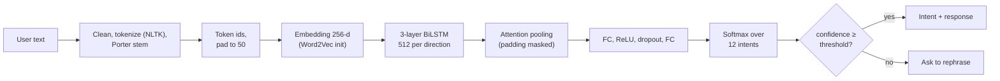
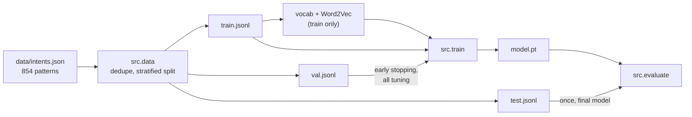

# Medical Intent Classifier

Intent classification for a healthcare chatbot. A PyTorch BiLSTM with attention maps a user message such as "my throat hurts" to one of 12 intents: 4 conversational ones (greeting, how are you, thanks, goodbye) and 8 symptoms (fever, cold, flu, cough, sore throat, congestion, shortness of breath, headache).

> **Not medical advice.** This is a portfolio and learning project. It doesn't diagnose anything. For medical concerns, consult a healthcare professional; in an emergency, contact local emergency services.

[](https://www.python.org/)
[](https://pytorch.org/)
[](LICENSE)

## Results

BiLSTM + attention baseline on a fixed, committed split (596 train / 128 validation / 128 test). Full details, environment, and commands are in [METRICS.md](METRICS.md).

| Split | Accuracy | Weighted F1 | Macro F1 |
|---|---|---|---|
| Validation | 0.969 | 0.969 | 0.967 |
| **Test** (evaluated once) | **0.891** | **0.892** | 0.866 |

| | Value |
|---|---|
| CPU latency per query (preprocessing + model) | p50 9.6 ms, p95 12.1 ms |
| Parameters | 16.3 M |
| Training time (CPU) | about 3 minutes |

Most test errors come from words the model never saw in training; see [docs/AUDIT.md](docs/AUDIT.md). The original version of this project reported 94.6% test accuracy, but that number came from an unseeded run: rerunning the identical original code gave 96.1% and 90.7%. Training is now deterministic.

## How it works



Training pipeline:



## Evaluation discipline

- The split is created once with a fixed seed and committed in `data/splits/`, so every model is scored on the same sentences.
- The vocabulary and Word2Vec embeddings are fitted on the training split only.
- Every decision (early stopping, hyperparameters, confidence threshold, where to add data) uses the **validation** split.
- The **test** split is evaluated once per final model, and every result is recorded in `METRICS.md`, including disappointing ones.

## Setup

Requires Python 3.11.

```bash
git clone https://github.com/Jinam-Shah/Medical-Intent-Classifier.git
cd Medical-Intent-Classifier
python -m venv .venv
# Windows: .venv\Scripts\activate     macOS/Linux: source .venv/bin/activate
pip install -r requirements-dev.txt --extra-index-url https://download.pytorch.org/whl/cpu
```

The NLTK tokenizer data (`punkt_tab`) downloads automatically on first use.

## Usage

```bash
# (Optional) recreate the split; the committed files are already there
python -m src.data --config configs/bilstm.yaml

# Train: reads train + val only, writes outputs/models/bilstm/model.pt and reports/bilstm/val/
python -m src.train --config configs/bilstm.yaml

# Evaluate on validation (any time) or test (once, for the final model)
python -m src.evaluate --split val
python -m src.evaluate --split test

# Predict
python -m src.predict "I have a fever" "my throat hurts"

# Latency benchmark
python -m src.benchmark --runs 500

# Interactive chatbot
python chatbot.py          # or: python run.py chat
python chatbot.py test     # sample inputs
```

Example prediction output:

```json
{
  "text": "my throat hurts",
  "intent": "sore_throat",
  "confidence": 0.9926,
  "top_k": [
    {"intent": "sore_throat", "confidence": 0.9926},
    {"intent": "greeting", "confidence": 0.0073},
    {"intent": "congestion", "confidence": 0.0001}
  ]
}
```

## REST API

```bash
uvicorn api.main:app --port 8000
# Interactive OpenAPI docs: http://localhost:8000/docs
```

| Method | Path | Purpose |
|---|---|---|
| `POST` | `/predict` | `{"text": "..."}` returns the intent, confidence, and top 3 intents |
| `POST` | `/predict/batch` | `{"texts": [...]}`, up to 64 texts |
| `GET` | `/health` | liveness, and whether the model is loaded |
| `GET` | `/model-info` | model name, labels, parameter count, threshold |

If the top confidence is below `CONFIDENCE_THRESHOLD`, the response says `"intent": "unsure"` and asks the user to rephrase. The best guess is still listed in `top_k`. Every response includes the medical disclaimer.

```bash
curl -X POST localhost:8000/predict -H "Content-Type: application/json" -d '{"text": "Hola"}'
```
```json
{
  "text": "Hola",
  "intent": "unsure",
  "confidence": 0.465,
  "is_confident": false,
  "top_k": [{"intent": "fever", "confidence": 0.465}, ...],
  "message": "I'm not sure what you mean. Could you rephrase, or describe your main symptom?",
  "disclaimer": "This service is a demo intent classifier and does not provide medical advice. ..."
}
```

Configuration (environment variables): `MODEL_PATH` (default `outputs/models/bilstm/model.pt`) and `CONFIDENCE_THRESHOLD` (default 0.75, provisional until it is chosen on validation).

## Tests

```bash
pytest
ruff check src tests
```

Tests cover text preprocessing, vocabulary encoding (padding, truncation, unknown words, empty input), deduplication, split stratification and disjointness, model output shapes, a check that a sentence gets the same prediction regardless of how much padding it has, and the API (every endpoint, the low-confidence path, batch/single consistency, and input validation) via FastAPI's `TestClient`. API tests use a tiny randomly initialised checkpoint, so they need no trained model.

## Project structure

```
configs/bilstm.yaml      hyperparameters and paths
data/intents.json        labeled patterns and responses
data/splits/             fixed train/val/test split + manifest
src/data.py              preprocessing, splitting, vocabulary
src/model.py             BiLSTM + attention
src/train.py             training with early stopping on validation
src/evaluate.py          metrics, report, confusion matrix, error list
src/predict.py           IntentClassifier for inference
src/benchmark.py         latency measurement
api/main.py              FastAPI app (endpoints, low-confidence fallback)
api/schemas.py           Pydantic request and response models
chatbot.py, run.py       command-line interface
reports/bilstm/          committed evaluation results and figures
docs/AUDIT.md            what the original code did, and what was fixed
docs/DECISIONS.md        design decisions
METRICS.md               every measured number, with commands
```

## Figures

Validation confusion matrix:


Test confusion matrix:


Training history:


## Known limitations

- **Small dataset:** 852 patterns. With 128 test sentences, one sentence is 0.78 points of accuracy, and the 95% confidence interval on test accuracy is roughly 82.5% to 93.4%.
- **Unseen words:** a word-level vocabulary maps unseen words to `<UNK>`. Sentences with unknown words are much less accurate (72% on test).
- **Overconfident on out-of-scope questions:** "Is this serious?" is classified as `headache` with 100% confidence, and "I'm feeling sick" as `fever` with 99.9%. A confidence threshold alone won't catch these; Phase 4 will measure this on held-out out-of-scope examples.
- **Single intent per message:** "fever and cough" gets one label.
- **No severity or duration intents**, and no conversation memory.
- **Oversized model:** 16 M parameters for about 600 training sentences. Kept to match the original; to be right-sized in the hyperparameter sweep.

## Roadmap

- [x] Phase 0: audit, reproducible pipeline, fixed split, honest metrics
- [ ] Phase 1: MLflow experiment tracking, model registry, hyperparameter sweep
- [ ] Phase 2: DistilBERT fine-tuning and comparison
- [ ] Phase 3: validation-driven data improvement
- [ ] Phase 4: FastAPI service, low-confidence fallback, ONNX export, Docker
- [ ] Phase 5: Gradio demo on Hugging Face Spaces
- [ ] Phase 6: GitHub Actions CI

## Author

**Jinam Shah**, [GitHub @Jinam-Shah](https://github.com/Jinam-Shah)

## License

MIT, see [LICENSE](LICENSE).
