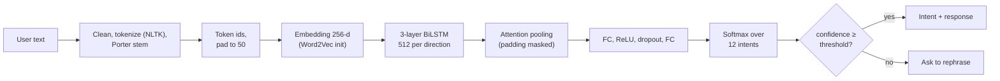
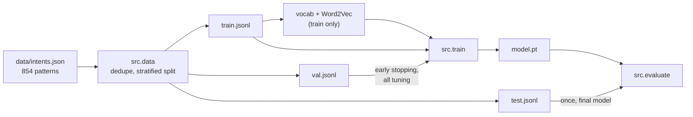
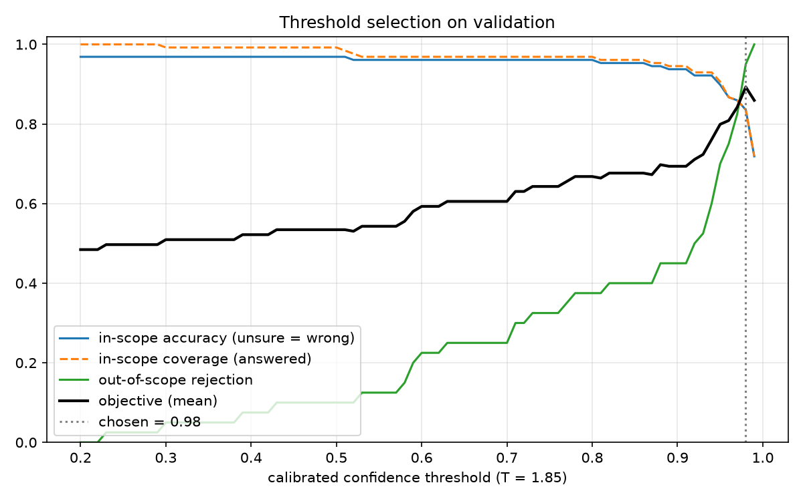
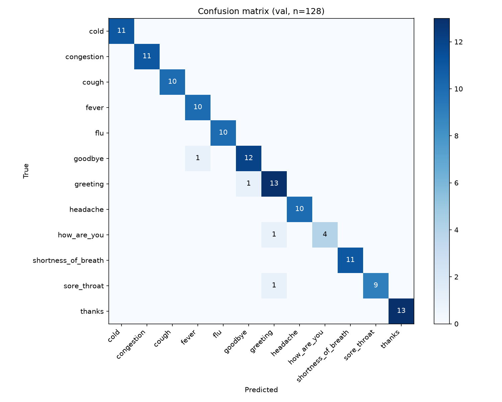
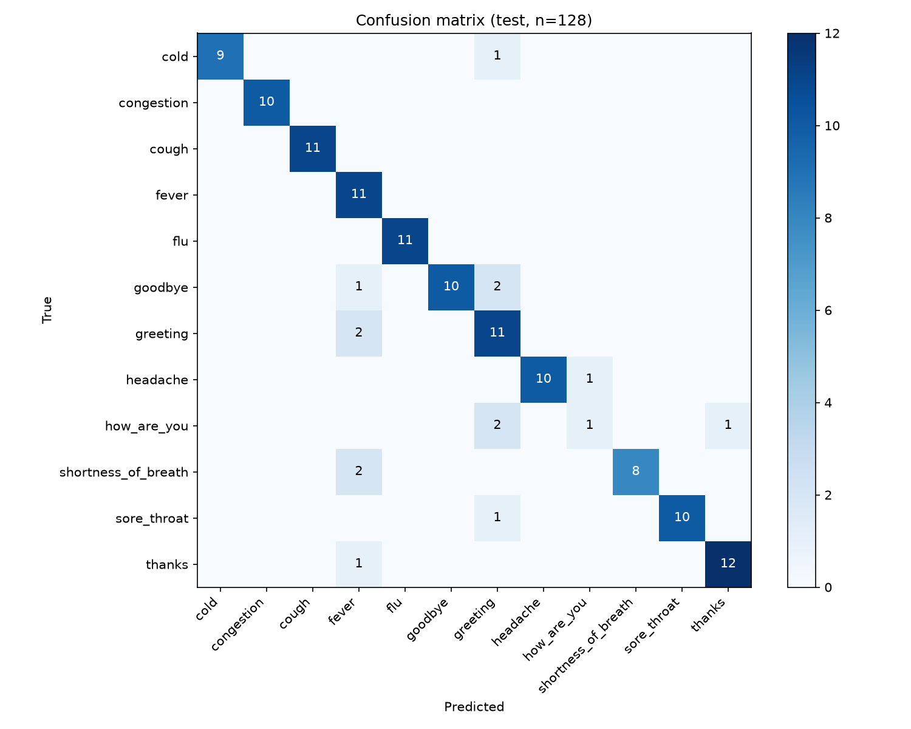
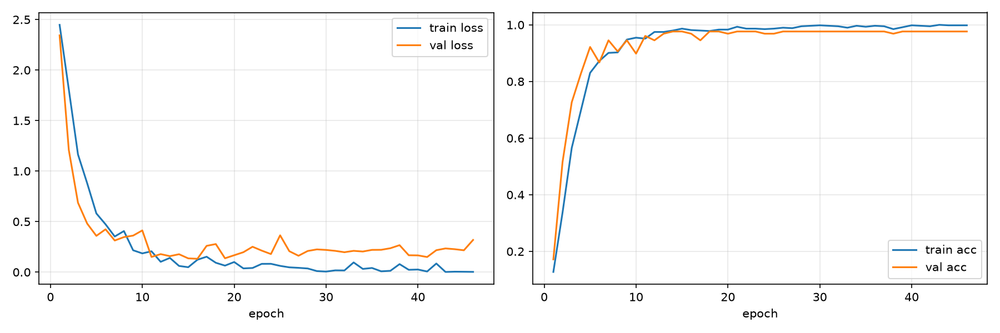

# Medical Intent Classifier

Intent classification for a healthcare chatbot. A PyTorch BiLSTM with attention maps a user message such as "my throat hurts" to one of 12 intents: 4 conversational ones (greeting, how are you, thanks, goodbye) and 8 symptoms (fever, cold, flu, cough, sore throat, congestion, shortness of breath, headache).

> **Not medical advice.** This is a portfolio and learning project. It doesn't diagnose anything. For medical concerns, consult a healthcare professional; in an emergency, contact local emergency services.

**Model on Hugging Face:** [Jinamshah/medical-intent-classifier](https://huggingface.co/Jinamshah/medical-intent-classifier) · **Live demo:** coming soon (Render free tier)

[](https://www.python.org/)
[](https://pytorch.org/)
[](LICENSE)

## Results

BiLSTM + attention baseline on a fixed, committed split (596 train / 128 validation / 128 test). Full details, environment, and commands are in [METRICS.md](METRICS.md).

| Split | Accuracy | Weighted F1 | Macro F1 |
|---|---|---|---|
| Validation | 0.969 | 0.969 | 0.967 |
| **Test** (evaluated once) | **0.891** | **0.892** | 0.866 |

With the calibrated low-confidence fallback (threshold chosen on validation, test evaluated once):

| Test split | No fallback | With fallback |
|---|---|---|
| Out-of-scope messages answered "unsure" | 0% | **82.5%** |
| In-scope messages answered | 100% | 82.8% |
| Accuracy when it does answer | 89.1% | **96.2%** |

| | Value |
|---|---|
| CPU latency per query, PyTorch (preprocessing + model) | p50 8.7 to 9.6 ms, p95 10.5 to 12.7 ms |
| CPU latency per query, **ONNX Runtime** | **p50 2.0 to 2.1 ms, p95 2.6 to 2.8 ms** (about 4.4× faster) |
| Parameters | 16.3 M |
| Training time (CPU) | about 3 minutes |
| Docker image (ONNX Runtime) | 604 MB, vs 2.34 GB with PyTorch |

Most test errors come from words the model never saw in training; see [docs/AUDIT.md](docs/AUDIT.md). The original version of this project reported 94.6% test accuracy, but that number came from an unseeded run: rerunning the identical original code gave 96.1% and 90.7%. Training is now deterministic.

## How it works



Training pipeline:



## Evaluation discipline

- The split is created once with a fixed seed and committed in `data/splits/`, so every model is scored on the same sentences.
- The vocabulary and Word2Vec embeddings are fitted on the training split only.
- Every decision (early stopping, hyperparameters, confidence threshold, where to add data) uses the **validation** split.
- The **test** split is evaluated once per final model, and every result is recorded in `METRICS.md`, including disappointing ones.

## Setup

Requires Python 3.11.

```bash
git clone https://github.com/Jinam-Shah/Medical-Intent-Classifier.git
cd Medical-Intent-Classifier
python -m venv .venv
# Windows: .venv\Scripts\activate     macOS/Linux: source .venv/bin/activate
pip install -r requirements-dev.txt --extra-index-url https://download.pytorch.org/whl/cpu
```

On Windows PowerShell, if activation fails with "running scripts is disabled on this system", allow it for the current window only with `Set-ExecutionPolicy -Scope Process Bypass`, or skip activation and call `.venv\Scripts\python -m ...` directly.

The NLTK tokenizer data (`punkt_tab`) downloads automatically on first use.

## Usage

```bash
# (Optional) recreate the split; the committed files are already there
python -m src.data --config configs/bilstm.yaml

# Train: reads train + val only, writes outputs/models/bilstm/model.pt and reports/bilstm/val/
python -m src.train --config configs/bilstm.yaml

# Evaluate on validation (any time) or test (once, for the final model)
python -m src.evaluate --split val
python -m src.evaluate --split test

# Predict
python -m src.predict "I have a fever" "my throat hurts"

# Export to ONNX (writes model.onnx next to the checkpoint and checks it matches PyTorch)
python -m src.export_onnx

# Latency benchmark
python -m src.benchmark --backend pytorch --runs 1000
python -m src.benchmark --backend onnx --runs 1000

# Interactive chatbot
python chatbot.py          # or: python run.py chat
python chatbot.py test     # sample inputs
```

Example prediction output:

```json
{
  "text": "my throat hurts",
  "intent": "sore_throat",
  "confidence": 0.9926,
  "top_k": [
    {"intent": "sore_throat", "confidence": 0.9926},
    {"intent": "greeting", "confidence": 0.0073},
    {"intent": "congestion", "confidence": 0.0001}
  ]
}
```

## REST API

```bash
uvicorn api.main:app --port 8000
# Interactive OpenAPI docs: http://localhost:8000/docs
```

| Method | Path | Purpose |
|---|---|---|
| `POST` | `/predict` | `{"text": "..."}` returns the intent, confidence, and top 3 intents |
| `POST` | `/predict/batch` | `{"texts": [...]}`, up to 64 texts |
| `GET` | `/health` | liveness, and whether the model is loaded |
| `GET` | `/model-info` | model name, labels, parameter count, threshold |

If the top confidence is below the threshold, the response says `"intent": "unsure"` and asks the user to rephrase. The best guess is still listed in `top_k`. Every response includes the medical disclaimer.

### How the threshold is chosen

The raw model is overconfident: most messages, including off-topic ones, score above 0.99. So the confidences are first **calibrated with temperature scaling**: the logits are divided by one number, T = 1.85, fitted on the validation set. This doesn't change any prediction; it only spreads out the confidences. The threshold (0.98) is then chosen on validation against 40 hand-written out-of-scope messages (`data/out_of_scope.json`), and the other 40 are kept for test.

```bash
python -m src.threshold --split val    # fit T, choose the threshold, write serving.json next to the model
python -m src.threshold --split test   # report once
```



The fallback trades coverage for safety: about 1 in 6 genuine messages get "please rephrase" (see [docs/DECISIONS.md](docs/DECISIONS.md) D15).

```bash
curl -X POST localhost:8000/predict -H "Content-Type: application/json" -d '{"text": "Hola"}'
```
```json
{
  "text": "Hola",
  "intent": "unsure",
  "confidence": 0.294,
  "is_confident": false,
  "top_k": [{"intent": "fever", "confidence": 0.294}, ...],
  "message": "I'm not sure what you mean. Could you rephrase, or describe your main symptom?",
  "disclaimer": "This service is a demo intent classifier and does not provide medical advice. ..."
}
```

Configuration (environment variables): `MODEL_BACKEND` (`pytorch` by default, or `onnx` to serve the exported model with ONNX Runtime, which needs no torch), `MODEL_PATH` (defaults to `outputs/models/bilstm/model.pt` or `model.onnx`), and, optionally, `CONFIDENCE_THRESHOLD` to override the validated threshold stored in `serving.json`.

## Docker

The image packages the trained and evaluated model; it doesn't train. Create the artifacts first (see Usage), then:

```bash
docker build -t medical-intent-classifier .
docker run --rm -p 8000:8000 medical-intent-classifier
# http://localhost:8000/docs
```

| Target | Serves with | Image size |
|---|---|---|
| `serve` (default) | ONNX Runtime API + Gradio chat UI at `/ui`, no torch, non-root, health check | 924 MB |
| `serve-api` | ONNX Runtime API only | **604 MB** |
| `serve-pytorch` | PyTorch API (`docker build --target serve-pytorch ...`) | 2.34 GB |

To build from the published Hugging Face Hub model instead of local files (this is what the hosted deploy does):

```bash
docker build --build-arg MODEL_SOURCE=hub --build-arg HF_MODEL_REPO=<user>/<repo>              --build-arg HF_MODEL_REVISION=<commit> -t medical-intent-classifier .
```

The image runs one ONNX Runtime thread (`ORT_NUM_THREADS=1`), because free hosting tiers give a fraction of a CPU. At 0.1 CPU and 512 MB it uses about 230 MB and answers `/predict` in about 8 ms ([METRICS.md](METRICS.md)).

The container reads `PORT` (default 8000), `MODEL_BACKEND`, `MODEL_PATH`, `CONFIDENCE_THRESHOLD`, `ENABLE_UI` and `ORT_NUM_THREADS`. Why the image doesn't train the model itself: [docs/DECISIONS.md](docs/DECISIONS.md) D18.

## Tests

```bash
pytest
ruff check src tests
```

Tests cover text preprocessing, vocabulary encoding (padding, truncation, unknown words, empty input), deduplication, split stratification and disjointness, model output shapes, a check that a sentence gets the same prediction regardless of how much padding it has, and the API (every endpoint, the low-confidence path, batch/single consistency, and input validation) via FastAPI's `TestClient`, plus temperature fitting and threshold scoring, ONNX/PyTorch parity, and a check that the ONNX serving path runs with torch imports blocked. API tests use a tiny randomly initialised checkpoint, so they need no trained model.

## Project structure

```
configs/bilstm.yaml      hyperparameters and paths
data/intents.json        labeled patterns and responses
data/splits/             fixed train/val/test split + manifest
src/data.py              preprocessing, splitting, vocabulary
src/model.py             BiLSTM + attention
src/train.py             training with early stopping on validation
src/evaluate.py          metrics, report, confusion matrix, error list
src/predict.py           IntentClassifier for inference
src/benchmark.py         latency measurement
src/threshold.py         temperature calibration and threshold selection
src/export_onnx.py       ONNX export and parity check
src/onnx_predict.py      torch-free ONNX Runtime classifier
src/serving.py           helpers shared by both backends (no torch)
data/out_of_scope.json   off-topic messages for choosing and testing the threshold
api/main.py              FastAPI app (endpoints, low-confidence fallback)
api/schemas.py           Pydantic request and response models
api/ui.py                Gradio chat UI, mounted at /ui when ENABLE_UI=1
src/hub.py               publish/download model artifacts on the Hugging Face Hub
Dockerfile               slim ONNX serving image (default) and a PyTorch variant
render.yaml              Render Blueprint for the free hosted demo
requirements-serve.txt   runtime-only dependencies for the slim image
requirements-ui.txt      adds Gradio for the UI image
chatbot.py, run.py       command-line interface
reports/bilstm/          committed evaluation results and figures
docs/AUDIT.md            what the original code did, and what was fixed
docs/DECISIONS.md        design decisions
METRICS.md               every measured number, with commands
```

## Figures

Validation confusion matrix:



Test confusion matrix:



Training history:



## Known limitations

- **Small dataset:** 852 patterns. With 128 test sentences, one sentence is 0.78 points of accuracy, and the 95% confidence interval on test accuracy is roughly 82.5% to 93.4%.
- **Unseen words:** a word-level vocabulary maps unseen words to `<UNK>`. Sentences with unknown words are much less accurate (72% on test).
- **Out-of-scope messages still slip through:** the fallback catches 82.5% of held-out off-topic messages, not all of them. Among those it misses is a safety-relevant one: "I have chest pain when I exercise" is answered as `headache` (0.983). A real product would need an explicit emergency-symptom check in front of the classifier; this demo doesn't have one.
- **The fallback also rejects some genuine messages:** 17% of in-scope test messages get "please rephrase", e.g. "my throat hurts" (0.93).
- **Single intent per message:** "fever and cough" gets one label.
- **No severity or duration intents**, and no conversation memory.
- **Oversized model:** 16 M parameters for about 600 training sentences. Kept to match the original; to be right-sized in the hyperparameter sweep.

## Roadmap

- [x] Phase 0: audit, reproducible pipeline, fixed split, honest metrics
- [ ] Phase 1: MLflow experiment tracking, model registry, hyperparameter sweep
- [ ] Phase 2: DistilBERT fine-tuning and comparison
- [ ] Phase 3: validation-driven data improvement
- [x] Phase 4: FastAPI service, calibrated low-confidence fallback, ONNX export, Docker
- [ ] Phase 5: Gradio demo on Hugging Face Spaces
- [ ] Phase 6: GitHub Actions CI

## Author

**Jinam Shah**, [GitHub @Jinam-Shah](https://github.com/Jinam-Shah)

## License

MIT, see [LICENSE](LICENSE).
